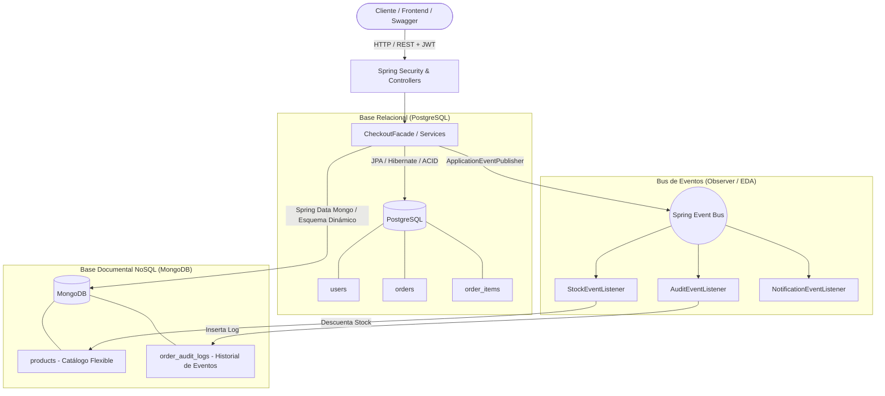
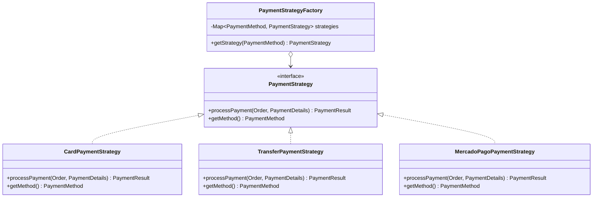
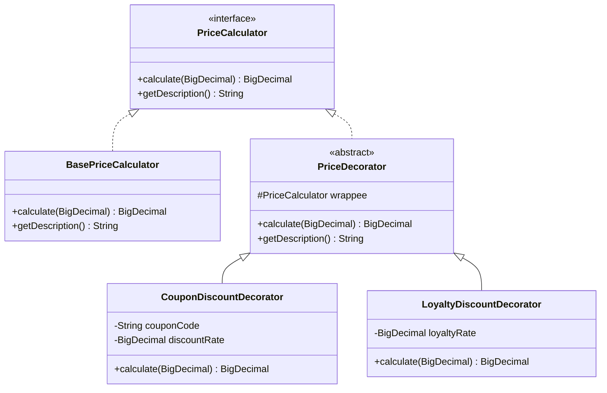
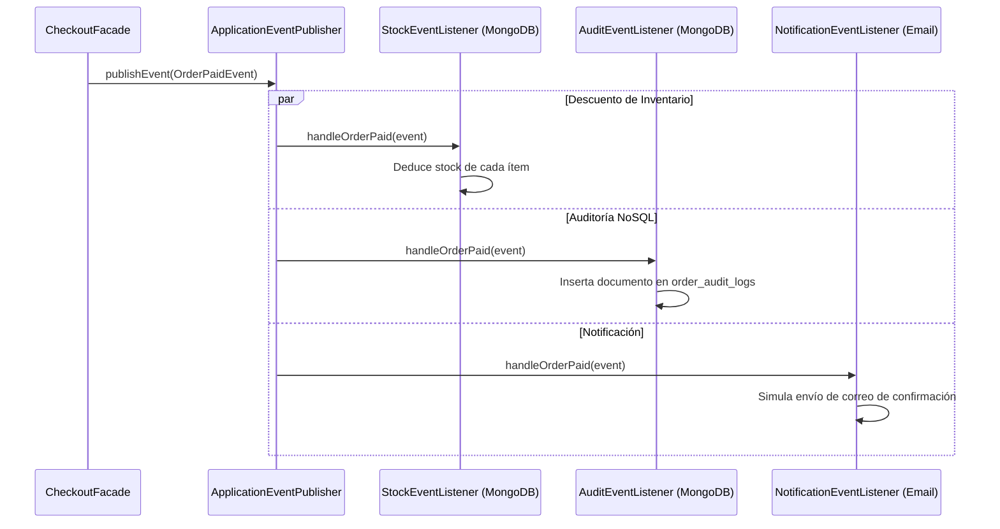

# Documentación Técnica - E-Commerce Shop API
**Arquitectura Políglota, Patrones de Diseño, Spring Boot y MongoDB**

---

## 1. Visión General de la Arquitectura

La aplicación implementa una **arquitectura políglota** que divide responsabilidades según las características naturales de los datos:



### Justificación de Almacenamiento

| Base de Datos | Módulo | Motivo Técnico |
| :--- | :--- | :--- |
| **PostgreSQL** | `user`, `order` | Transacciones ACID, integridad referencial con claves foráneas, consistencia fuerte al procesar cobros y asociar ítems con sus órdenes. |
| **MongoDB** | `product`, auditoría | Esquema dinámico para productos con atributos heterogéneos (talles, especificaciones de hardware, colores) y logs de auditoría no estructurados. |

---

## 2. Coexistencia de PostgreSQL y MongoDB en Spring Boot

Cuando se combinan JPA y MongoDB en un mismo proyecto, Spring Data puede confundir qué repositorio pertenece a qué tecnología. La solución limpia consiste en aislar los paquetes de escaneo:

### Configuración JPA (`JpaConfig.java`)
```java
@Configuration
@EnableJpaAuditing
@EnableJpaRepositories(basePackages = {
        "com.grz.shop_api.user.infrastructure",
        "com.grz.shop_api.order.infrastructure"
})
public class JpaConfig { }
```

### Configuración MongoDB (`MongoConfig.java`)
```java
@Configuration
@EnableMongoAuditing
@EnableMongoRepositories(basePackages = {
        "com.grz.shop_api.product.infrastructure",
        "com.grz.shop_api.order.infrastructure"
})
public class MongoConfig { }
```

---

## 3. Guía Práctica de MongoDB (Para Desarrolladores Relacionales)

MongoDB es una base de datos **NoSQL orientada a documentos**. En lugar de tablas con columnas fijas y filas, almacena **Colecciones** con **Documentos BSON** (formato JSON binario).

### Conceptos Clave
- **Tabla (SQL)** ➔ **Colección (MongoDB)**
- **Fila (SQL)** ➔ **Documento (MongoDB)**
- **Columna (SQL)** ➔ **Campo / Clave (MongoDB)**
- **Clave Primaria (SQL)** ➔ **`_id` (Cadena alfanumérica única)**

### 3.1 Modelo de Producto Dinámico (`Product.java`)

```java
@Document(collection = "products") // Indica que se almacena en la colección "products"
@Getter @Setter @Builder
public class Product {

    @Id // Clave primaria de MongoDB (ObjectId generado o asignado como String)
    private String id;

    @Indexed(unique = true) // Índice único a nivel de motor para búsquedas rápidas
    private String sku;

    private String name;
    private BigDecimal price;
    private Integer stock;

    @Indexed // Índice simple para filtrar por categoría eficientemente
    private String category;

    // MAGIA DE MONGO: Atributos completamente variables por tipo de producto
    @Builder.Default
    private Map<String, Object> attributes = new HashMap<>();

    private boolean active;
}
```

#### ¿Cómo se guarda en MongoDB?
Un producto tecnológico y una zapatilla pueden convivir en la misma colección con datos totalmente distintos sin alterar ninguna tabla:

```json
// Documento 1: Celular
{
  "_id": "6716a4b1f812",
  "sku": "TECH-PHN-001",
  "name": "Smartphone Ultra 5G",
  "price": 999.99,
  "stock": 25,
  "category": "Electrónica",
  "attributes": {
    "pantalla": "6.7 pulgadas AMOLED",
    "ram": "8GB",
    "almacenamiento": "256GB"
  }
}

// Documento 2: Calzado
{
  "_id": "6716a4b1f813",
  "sku": "CLOTH-SHOE-002",
  "name": "Zapatillas Running Pro",
  "price": 129.50,
  "stock": 50,
  "category": "Indumentaria",
  "attributes": {
    "talle": "42",
    "color": "Gris / Naranja",
    "genero": "Unisex"
  }
}
```

### 3.2 Repositorio Mongo (`ProductRepository.java`)
Spring Data deriva las consultas BSON a partir de los nombres de los métodos:

```java
@Repository
public interface ProductRepository extends MongoRepository<Product, String> {
    List<Product> findByActiveTrue();
    List<Product> findByCategoryIgnoreCaseAndActiveTrue(String category);
    Optional<Product> findBySku(String sku);
}
```

---

## 4. Patrones de Diseño Implementados

### 4.1 Patrón Strategy + Factory (Procesamiento de Pagos)

Permite soportar múltiples métodos de pago (Tarjeta, Transferencia, MercadoPago) desacoplando la lógica de cobro del flujo del pedido.



#### Código de la Estrategia (`PaymentStrategy.java`)
```java
public interface PaymentStrategy {
    PaymentResult processPayment(Order order, PaymentDetails details);
    PaymentMethod getMethod();
}
```

#### Implementación Concreta (`CardPaymentStrategy.java`)
```java
@Component
public class CardPaymentStrategy implements PaymentStrategy {
    @Override
    public PaymentResult processPayment(Order order, PaymentDetails details) {
        if (details == null || !StringUtils.hasText(details.cardNumber())) {
            throw new PaymentFailedException("Datos de tarjeta incompletos");
        }
        String txId = "TX-CARD-" + UUID.randomUUID().toString().substring(0, 8);
        return PaymentResult.success(txId, "Pago aprobado por $" + order.getFinalAmount());
    }

    @Override
    public PaymentMethod getMethod() {
        return PaymentMethod.CARD;
    }
}
```

#### Factory con Inyección de Dependencias (`PaymentStrategyFactory.java`)
Spring inyecta automáticamente todas las clases que implementan `PaymentStrategy` en la lista del constructor:

```java
@Component
public class PaymentStrategyFactory {
    private final Map<PaymentMethod, PaymentStrategy> strategies = new EnumMap<>(PaymentMethod.class);

    public PaymentStrategyFactory(List<PaymentStrategy> strategyList) {
        for (PaymentStrategy strategy : strategyList) {
            strategies.put(strategy.getMethod(), strategy);
        }
    }

    public PaymentStrategy getStrategy(PaymentMethod method) {
        PaymentStrategy strategy = strategies.get(method);
        if (strategy == null) {
            throw new BusinessRuleException("Método de pago no soportado: " + method);
        }
        return strategy;
    }
}
```

---

### 4.2 Patrón Decorator (Cálculo Dinámico de Descuentos en Capas)

Permite calcular precios agregando reglas de forma acumulativa sin alterar la clase base ni anidar `if/else`.



#### Uso en el Checkout (`CheckoutFacade.java`):
```java
// 1. Iniciamos con el calculador base
PriceCalculator calculator = new BasePriceCalculator();

// 2. Si hay cupón, envolvemos con el decorador de cupón (ej. -10%)
if (StringUtils.hasText(request.couponCode())) {
    calculator = new CouponDiscountDecorator(calculator, request.couponCode(), new BigDecimal("0.10"));
}

// 3. Si el cliente es frecuente, envolvemos con el decorador de fidelidad (-5%)
if (request.loyaltyMember()) {
    calculator = new LoyaltyDiscountDecorator(calculator, new BigDecimal("0.05"));
}

// 4. El precio final se calcula recorriendo las capas envueltas
BigDecimal finalPrice = calculator.calculate(baseTotal);
String breakdown = calculator.getDescription();
// breakdown -> "Precio base + Cupón [PROMO10: -10%] + Descuento Cliente Frecuente (-5%)"
```

---

### 4.3 Patrón State (Ciclo de Vida del Pedido)

Garantiza que el pedido solo pueda avanzar a través de estados válidos según reglas de negocio formales:

```
[CREATED] ──── pay() ────► [PAID] ──── ship() ────► [SHIPPED] ──── deliver() ────► [DELIVERED]
    │                        │
  cancel()                 cancel()
    ▼                        ▼
[CANCELLED]              [CANCELLED]
```

#### Interfaz del Estado (`OrderState.java`)
```java
public interface OrderState {
    void pay(OrderContext context);
    void ship(OrderContext context);
    void deliver(OrderContext context);
    void cancel(OrderContext context);
    OrderStatus getStatus();
}
```

#### Estado Creado (`CreatedState.java`):
```java
public class CreatedState implements OrderState {
    @Override
    public void pay(OrderContext context) {
        context.setState(new PaidState()); // Transición legal
    }

    @Override
    public void ship(OrderContext context) {
        // Regla: No puedes enviar lo que no fue pagado
        throw new BusinessRuleException("El pedido no puede ser enviado porque aún no ha sido pagado.");
    }

    @Override
    public void deliver(OrderContext context) {
        throw new BusinessRuleException("El pedido debe ser pagado y enviado antes de entregarse.");
    }

    @Override
    public void cancel(OrderContext context) {
        context.setState(new CancelledState());
    }

    @Override
    public OrderStatus getStatus() { return OrderStatus.CREATED; }
}
```

---

### 4.4 Patrón Observer / Event-Driven (Spring Application Events)

Al confirmar el pago de una orden, se desacoplan las tareas secundarias mediante eventos:



#### Emisión del Evento (`CheckoutFacade.java`):
```java
// El Facade solo publica el hecho consumado, sin saber qué observadores reaccionarán
eventPublisher.publishEvent(OrderPaidEvent.of(completedOrder));
```

#### Observador de Auditoría en MongoDB (`AuditEventListener.java`):
```java
@Component
@RequiredArgsConstructor
public class AuditEventListener {

    private final OrderAuditLogRepository auditLogRepository;

    @EventListener
    public void handleOrderPaid(OrderPaidEvent event) {
        Order order = event.order();
        
        OrderAuditLog auditLog = OrderAuditLog.builder()
                .orderId(order.getId().toString())
                .orderNumber(order.getOrderNumber())
                .eventType("ORDER_PAID")
                .status(order.getStatus().name())
                .message("Pago confirmado con método " + order.getPaymentMethod())
                .details(Map.of(
                        "paymentMethod", order.getPaymentMethod().name(),
                        "transactionId", order.getPaymentTransactionId(),
                        "finalAmount", order.getFinalAmount()
                ))
                .timestamp(event.occurredOn())
                .build();

        auditLogRepository.save(auditLog); // Persistido en MongoDB
    }
}
```

---

### 4.5 Patrón Facade (`CheckoutFacade.java`)

Orquesta y simplifica todo el flujo de compra para que el controlador solo interactúe con un único punto de entrada:

```java
@Transactional
public CheckoutResponse checkout(UUID userId, CheckoutRequest request) {
    // 1. Valida stock en MongoDB (ProductService)
    // 2. Construye entidad Order e ítems en PostgreSQL
    // 3. Aplica patrón Decorator sobre el precio base
    // 4. Guarda pedido inicial (CREATED)
    // 5. Ejecuta cobro con Strategy & Factory
    // 6. Transiciona estado a PAID con patrón State
    // 7. Guarda pedido actualizado con ID de transacción
    // 8. Publica OrderPaidEvent para que reaccionen los Observers
    // 9. Retorna DTO limpio al cliente
}
```

---

## 5. Configuración y Uso de Swagger / OpenAPI 3

La documentación interactiva se genera automáticamente a partir del código mediante `springdoc-openapi-starter-webmvc-ui`.

### 5.1 Configuración de Seguridad JWT (`OpenApiConfig.java`)

Define el esquema `BearerAuth` para que Swagger muestre el candado interactivo:

```java
@Configuration
public class OpenApiConfig {

    public static final String SECURITY_SCHEME_NAME = "BearerAuth";

    @Bean
    public OpenAPI shopOpenAPI() {
        return new OpenAPI()
                .info(new Info()
                        .title("E-Commerce Shop API")
                        .version("1.0.0")
                        .description("API RESTful: PostgreSQL (Órdenes/Usuarios) + MongoDB (Catálogo/Auditoría)"))
                .addSecurityItem(new SecurityRequirement().addList(SECURITY_SCHEME_NAME))
                .components(new Components().addSecuritySchemes(SECURITY_SCHEME_NAME,
                        new SecurityScheme()
                                .name(SECURITY_SCHEME_NAME)
                                .type(SecurityScheme.Type.HTTP)
                                .scheme("bearer")
                                .bearerFormat("JWT")));
    }
}
```

### 5.2 Uso en los Controladores (`OrderController.java`)

```java
@RestController
@RequestMapping("/api/v1/orders")
@Tag(name = "Orders", description = "Gestión de Pedidos, Checkout y Auditoría de Eventos")
@SecurityRequirement(name = SECURITY_SCHEME_NAME)
public class OrderController {

    @PostMapping("/checkout")
    @Operation(summary = "Realizar Checkout de un pedido",
               description = "Orquesta stock en MongoDB, cálculo de descuentos con Decorator, cobro con Strategy y eventos.")
    public ResponseEntity<CheckoutResponse> checkout(...) { ... }
}
```

---

## 6. Flujo de Prueba Paso a Paso (End-to-End)

1. Abre el navegador en: **`http://localhost:8080/swagger-ui.html`**.
2. **Iniciar Sesión:**
   - Despliega `POST /api/v1/auth/login`.
   - Credenciales: `customer@shop.com` / `customer123`.
   - Copia el campo `accessToken` de la respuesta JSON.
3. **Autenticar Swagger:**
   - Haz clic en el botón superior derecho **Authorize** (candado verde).
   - Pega el token JWT y pulsa **Authorize**.
4. **Ver Catálogo (MongoDB):**
   - Ejecuta `GET /api/v1/products`. Copia el `id` de uno de los productos (ej. el Smartphone).
5. **Realizar Checkout (Facade + Todos los Patrones):**
   - Ejecuta `POST /api/v1/orders/checkout`:
   ```json
   {
     "items": [
       {
         "productId": "<pega_aqui_el_id_de_mongo>",
         "quantity": 1
       }
     ],
     "shippingAddress": "Av. Santa Fe 2500, CABA",
     "paymentMethod": "CARD",
     "paymentDetails": {
       "cardNumber": "4500123456789999",
       "cardHolderName": "Juan Perez",
       "expirationDate": "12/28",
       "cvv": "123"
     },
     "couponCode": "PROMO10",
     "loyaltyMember": true
   }
   ```
6. **Verificar Resultados:**
   - **Respuesta HTTP 201:** Contiene la orden con estado `PAID` y el desglose de precio con descuentos acumulados.
   - **Stock:** Si vuelves a consultar el producto en `GET /api/v1/products/{id}`, el stock se habrá reducido en 1 unidad automáticamente (vía `StockEventListener`).
   - **Auditoría:** Si consultas `GET /api/v1/orders/{orderId}/audit` con usuario administrador (`admin@shop.com` / `admin123`), verás los registros capturados en MongoDB por `AuditEventListener`.
