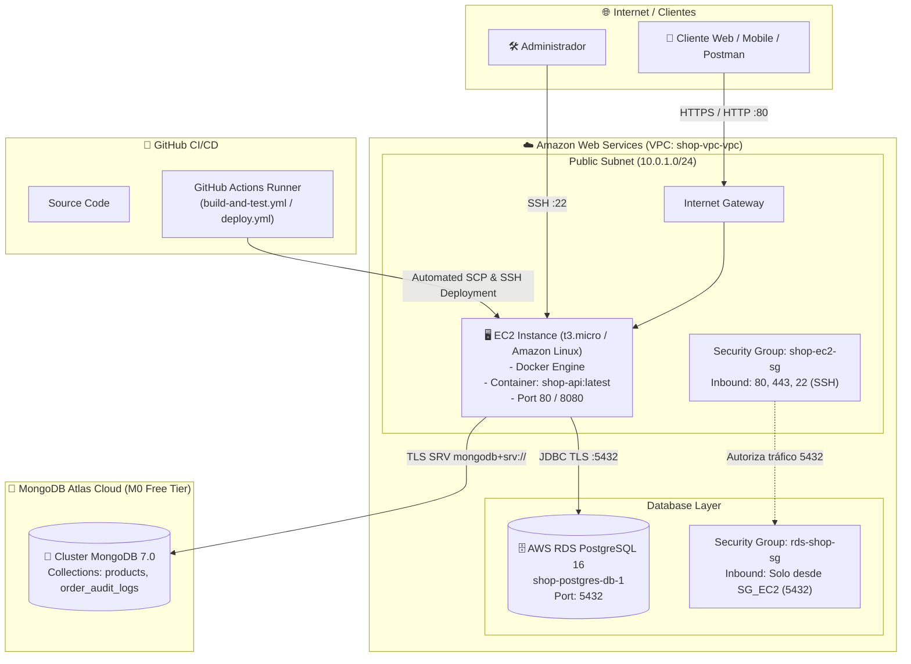

# 🛒 Shop API — Enterprise E-Commerce Core & Cloud Architecture

[](https://openjdk.org/)
[](https://spring.io/projects/spring-boot)
[](https://www.postgresql.org/)
[](https://www.mongodb.com/)
[](https://aws.amazon.com/)
[-success.svg)](#-suite-de-pruebas-unitarias-y-de-integración)

**Shop API** es una solución de backend modular y de alto rendimiento diseñada bajo los principios de **Clean Architecture** y **Domain-Driven Design (DDD)**. Implementa persistencia híbrida (**Políglota**) combinando **PostgreSQL** para la consistencia transaccional y **MongoDB** para la flexibilidad de catálogo y auditoría de eventos en tiempo real.

---

## 📌 Tabla de Contenidos
1. [Resumen del Proyecto](#-resumen-del-proyecto)
2. [Arquitectura de Persistencia Híbrida (Políglota)](#-persistencia-híbrida)
3. [Patrones de Diseño de Software (GoF)](#-patrones-de-diseño-gof-implementados)
4. [Arquitectura Cloud en AWS](#-arquitectura-cloud-en-amazon-web-services-aws)
5. [Pipeline de CI/CD (GitHub Actions)](#-pipeline-de-cicd-github-actions)
6. [Suite de Pruebas](#-suite-de-pruebas-unitarias-y-de-integración)
7. [Guía de Inicio Rápido (Local)](#-guía-de-inicio-rápido)
8. [Endpoints Principales & Documentación OpenAPI](#-documentación-de-la-api)

---

## 🚀 Resumen del Proyecto

El sistema gestiona de extremo a extremo el ciclo de vida de compras de una tienda digital:
* **Autenticación y Autorización**: Seguridad basada en JWT con control de roles (`ROLE_CUSTOMER`, `ROLE_ADMIN`).
* **Catálogo Flexible**: Gestión de productos con atributos dinámicos (color, tallas, especificaciones técnicas).
* **Motor de Precios Dinámico**: Aplicación acumulable de cupones y descuentos por fidelidad.
* **Múltiples Pasarelas de Pago**: Tarjeta de crédito/débito, transferencia bancaria y Mercado Pago.
* **Ciclo de Vida de Órdenes**: Máquina de estados finita que gobierna las transiciones legales de un pedido.
* **Auditoría Orientada a Eventos**: Registro inmutable de cada cambio de estado para trazabilidad empresarial.

---

## 💾 Persistencia Híbrida

| Base de Datos | Rol en la Arquitectura | Entidades / Colecciones | Ventaja Clave |
| :--- | :--- | :--- | :--- |
| **PostgreSQL 16** (Relacional) | Consistencia Transaccional ACID | `users`, `orders`, `order_items` | Integridad referencial en pagos y transacciones críticas. Versionado de esquemas con **Flyway**. |
| **MongoDB 7** (Documental) | Flexibilidad & Alta Disponibilidad | `products`, `order_audit_logs` | Atributos polimórficos de productos sin esquemas fijos; logs de auditoría masivos sin bloquear tablas relacionales. |

---

## 🧠 Patrones de Diseño (GoF) Implementados

| Patrón | Propósito en el Dominio | Ubicación en el Código |
| :--- | :--- | :--- |
| **Facade** | Simplifica el proceso complejo de Checkout coordinando catálogo, descuentos, pasarelas de pago y emisión de eventos en una interfaz unificada. | [`CheckoutFacade.java`](file:///E:/workspace-intelij/shop-api/src/main/java/com/grz/shop_api/order/application/CheckoutFacade.java) |
| **State** | Controla el ciclo de vida del pedido (`CREATED` ➔ `PAID` ➔ `SHIPPED` ➔ `DELIVERED` o `CANCELLED`), prohibiendo transiciones ilegales. | [`OrderState.java`](file:///E:/workspace-intelij/shop-api/src/main/java/com/grz/shop_api/order/domain/state/OrderState.java) |
| **Strategy** | Encapsula algoritmos de pago intercambiables (Tarjeta, Transferencia bancaria, Mercado Pago). | [`PaymentStrategy.java`](file:///E:/workspace-intelij/shop-api/src/main/java/com/grz/shop_api/order/domain/payment/PaymentStrategy.java) |
| **Factory Method** | Centraliza la resolución dinámica y segura de la estrategia de pago según la opción seleccionada. | [`PaymentStrategyFactory.java`](file:///E:/workspace-intelij/shop-api/src/main/java/com/grz/shop_api/order/domain/payment/PaymentStrategyFactory.java) |
| **Decorator** | Aplica reglas de cálculo de precios y descuentos acumulativos en capas (Cupones promocionales, Descuento cliente VIP). | [`PriceDecorator.java`](file:///E:/workspace-intelij/shop-api/src/main/java/com/grz/shop_api/order/domain/pricing/PriceDecorator.java) |
| **Observer** | Desacopla la lógica post-compra: al dispararse un evento de pedido, se descuenta inventario, se audita en Mongo y se envían notificaciones. | [`StockEventListener.java`](file:///E:/workspace-intelij/shop-api/src/main/java/com/grz/shop_api/order/event/listener/StockEventListener.java) |
| **Builder** | Construcción inmutable y fluida de objetos de dominio y respuestas DTO mediante Lombok `@Builder`. | `Order.builder()`, `Product.builder()` |

---

## ☁️ Arquitectura Cloud en Amazon Web Services (AWS)

La infraestructura está diseñada siguiendo las mejores prácticas del **AWS Well-Architected Framework**, separando la red pública de cómputo del almacenamiento relacional mediante grupos de seguridad aislados.



### Componentes de la Infraestructura
1. **AWS VPC (`shop-vpc-vpc`)**: Red virtual dedicada con aislamiento por CIDR IPv4 (`10.0.0.0/16`).
2. **AWS EC2 (Host de Cómputo)**:
   - Instancia `t3.micro` con Docker Engine y Docker Compose.
   - Despliegue del contenedor `shop-api` con reinicio automático (`restart: unless-stopped`) y healthcheck.
3. **AWS RDS PostgreSQL 16 (`shop-postgres-db-1`)**:
   - Base de datos relacional administrada con almacenamiento GP3 SSD.
   - Firewall virtual (**Security Group**) configurado para aceptar tráfico en el puerto `5432` únicamente desde la instancia EC2.
4. **MongoDB Atlas (Database as a Service)**:
   - Clúster M0 en la nube con réplica y autenticación SCRAM-SHA-256 / TLS.
   - Almacena catálogo de productos y registros de auditoría de órdenes.

---

## 🔄 Pipeline de CI/CD (GitHub Actions)

El ciclo de integración y despliegue continuo se compone de dos flujos secuenciales desacoplados:

```mermaid
flowchart LR
    A["Push a rama main"] --> B["Build & Test Workflow"]
    B -->|1. Setup Java 21| C["2. Compilación y 73 Tests"]
    C -->|3. mvn package| D["4. Sube shop-api.jar como Artifact"]
    D --> E["Deploy Workflow (workflow_run)"]
    E -->|Descarga JAR compilado| F["SCP JAR + Compose a EC2"]
    F -->|SSH Command| G["docker compose up -d --build"]
    G --> H["🚀 Despliegue en Vivo"]
```



1. **`build-and-test.yml`**:
   - Se ejecuta en cada `push` o `pull_request` a `main`.
   - Levanta entorno Java 21, compila el código y ejecuta los **73 tests** automatizados con H2 en memoria y mocks.
   - Empaqueta el artefacto `shop-api.jar` sin recrear compilaciones redundantes.
2. **`deploy.yml`**:
   - Se dispara automáticamente al finalizar con éxito el workflow de build.
   - Transfiere el JAR empaquetado y las configuraciones de Docker a la máquina EC2 mediante SSH.
   - Levanta el contenedor de producción inyectando las variables de entorno de AWS RDS y Mongo Atlas.

---

## 🧪 Suite de Pruebas Unitarias y de Integración

El proyecto cuenta con **75 pruebas automatizadas** que garantizan una alta cobertura en capas de Dominio, Aplicación, Eventos, Web y persistencia con Contenedores Reales:

```
[INFO] Results:
[INFO] Tests run: 75, Failures: 0, Errors: 0, Skipped: 2 (o 75 pasados con Docker activo)
[INFO] BUILD SUCCESS
```

### Desglose de Pruebas:
* **Integración E2E con Testcontainers (`ShopApiTestcontainersIntegrationTest`)**: 2 tests ejecutando PostgreSQL 16 y MongoDB 7 reales con migraciones Flyway automáticas, verificando persistencia transaccional y auditoría viva.
* **Patrón State (`OrderStateTest`)**: 8 tests validando transiciones legales y prohibición de saltos de estado inválidos.
* **Patrón Decorator (`PriceDecoratorTest`)**: 4 tests para cálculo de base, cupones y descuentos apilados.
* **Patrones Strategy & Factory (`PaymentStrategyFactoryTest`)**: 5 tests para selección y ejecución de pasarelas de pago.
* **Patrón Facade (`CheckoutFacadeTest`)**: 4 tests verificando la orquestación integral de compra con Mockito y ArgumentCaptors.
* **Patrón Observer (`OrderEventListenerTest`)**: 9 tests para descuento/reintegro de stock, logs en MongoDB y notificaciones ante eventos.
* **Servicios de Aplicación (`OrderServiceTest`, `ProductServiceTest`, `AuthServiceTest`, `UserServiceTest`)**: 20 tests de reglas de negocio y excepciones de dominio.
* **Controladores Web Slice (`OrderControllerTest`, `ProductControllerTest`, `AuthControllerTest`, `UserControllerTest`)**: 22 tests MockMvc validando contratos HTTP, códigos de estado (200, 201, 204, 400, 401, 404, 409) y respuestas RFC 7807 (`ProblemDetail`).
* **Contexto Spring (`ShopApiApplicationTests`)**: 1 test de verificación de arranque del contenedor de beans.

---

## ⚡ Guía de Inicio Rápido

### Prerrequisitos
* **Java 21** JDK instalado.
* **Docker & Docker Compose** (opcional para ejecución en contenedores locales).

### 1. Clonar el repositorio
```bash
git clone https://github.com/tu-usuario/shop-api.git
cd shop-api
```

### 2. Ejecutar con bases de datos locales (Docker Compose)
Para levantar PostgreSQL y MongoDB localmente:
```bash
docker compose up -d postgres mongodb
```

### 3. Ejecutar la aplicación
```bash
# Windows
.\mvnw.cmd spring-boot:run

# Linux / macOS
./mvnw spring-boot:run
```

### 4. Ejecutar la suite completa de pruebas
```bash
# Windows
.\mvnw.cmd test

# Linux / macOS
./mvnw test
```

---

## 📖 Documentación de la API

Una vez iniciada la aplicación, la documentación interactiva OpenAPI / Swagger está disponible en:
* **Swagger UI**: [http://localhost:8080/swagger-ui.html](http://localhost:8080/swagger-ui.html)
* **OpenAPI Spec JSON**: [http://localhost:8080/v3/api-docs](http://localhost:8080/v3/api-docs)

### Endpoints Principales

| Módulo | Método | Endpoint | Descripción | Acceso |
| :--- | :--- | :--- | :--- | :--- |
| **Auth** | `POST` | `/api/v1/auth/register` | Registro de nuevos usuarios y generación de JWT | Público |
| **Auth** | `POST` | `/api/v1/auth/login` | Autenticación de credenciales | Público |
| **Products** | `GET` | `/api/v1/products` | Catálogo con filtro opcional por categoría | Público |
| **Products** | `GET` | `/api/v1/products/{id}` | Detalle de producto por ID | Público |
| **Products** | `POST` | `/api/v1/products` | Creación de productos con atributos dinámicos | `ROLE_ADMIN` |
| **Orders** | `POST` | `/api/v1/orders/checkout` | Orquestación completa de Checkout (Facade) | `ROLE_CUSTOMER` |
| **Orders** | `GET` | `/api/v1/orders/my-orders` | Historial de pedidos del usuario autenticado | Autenticado |
| **Orders** | `GET` | `/api/v1/orders/{id}` | Consulta de orden por ID | Autenticado |
| **Orders** | `PATCH` | `/api/v1/orders/{id}/status` | Transición legal de estado del pedido (State) | `ROLE_ADMIN` |
| **Orders** | `GET` | `/api/v1/orders/{id}/audit` | Historial de auditoría no estructurado en MongoDB | `ROLE_ADMIN` |
| **Users** | `GET` | `/api/v1/users/me` | Consulta del perfil autenticado actual | Autenticado |
